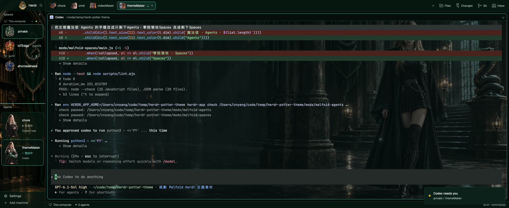

# Malfoid · 墨綠魔法學院

Herdr 原生桌面主題，以 `malfoid/` 角色照片和「奇幻女巫角色狀態素材表」為參考。
配色取自使用者提供的 GX10 主控台截圖：近黑墨綠、薄荷綠、青綠與古金色。



## 畫面與狀態

- 190px 側欄、60px Space 列搭配 48px 四學院徽章，以及四態角色卡；收合時改用頭像。
- Spaces 與 Agents 之間使用 2px 青綠分隔線；右側四種面板共用左側欄底圖，覆以半透明墨綠底色。
- 閒置抱書、等待指示托球、完成微笑舉杖；工作中每 3 秒切換「施法中」「思考中」，文字與姿態同步，相鄰 agent 交錯顯示不同動作。
- 工作姿態與其他狀態都使用 PNG，6 秒一輪；工作狀態燈以原生 opacity 動畫呼吸。
- 所有分頁均隨機分配角色頭像，包含一般終端與非 AI 程式；配圖按 Tab ID 保存，10 張用完才重複。Files／Changes／Git 面板沿用本機既有操作。
- Files／Changes／Watch／Git 面板空狀態使用 72px 全彩房間圖示：書本、魔藥、大廳、天文台。
- 終端背景使用新完成的寬版哥德式走廊圖，以 `cover` 滿版顯示；終端底色不透明度為 0.35。

| 用途 | 色碼 |
| --- | --- |
| 背景 | `#050E0B` |
| 面板 | `#061710` |
| 邊框 | `#1F4637` |
| 文字／次要文字 | `#E8F0EC` / `#8FA89D` |
| 工作／焦點 | `#60C5B0` |
| 完成 | `#73DD98` |
| 等待操作 | `#D4AF37` |

## 驗證

需要 Node.js 與 Herdr；沒有第三方 npm 套件。

```sh
node --test
node scripts/lint.mjs
herdr-app check mods/malfoid-agents
herdr-app check mods/malfoid-tabs
herdr-app check mods/malfoid-spaces
herdr-app check mods/malfoid-chrome
herdr-app check mods/malfoid-files
herdr-app check mods/malfoid-changes
herdr-app check mods/malfoid-inbox
herdr-app check mods/malfoid-git-graph
```

`lint` 執行 JavaScript 語法與 JSON 解析檢查。原生模組檢查還需搭配實機畫面，
因為 `herdr-app check` 不涵蓋所有互動、非同步狀態與版面配置。

## 安裝與切換

這版配合目前本機 Herdr 0.1.12，依賴已安裝的 `inbox`、`git-graph`，
以及 Herdr 內建的 pane、files、changes、workspace-status、menu、new-menu、picker、machine-add、workspace-chrome。

```sh
node scripts/install.mjs
```

安裝程式會預先確認依賴與撞名，只新增八個 `malfoid-*` 模組、layout、預覽與 theme。
已存在任何同名目的路徑就停止；已安裝者更新用 `node scripts/install.mjs --update`，只覆寫 `malfoid-*` 路徑，修改會熱重載。
安裝不切換畫面；先對安裝後的八個模組執行原生檢查，再切換：

```sh
herdr-app check ~/.config/herdr-app/mods/malfoid-agents
herdr-app check ~/.config/herdr-app/mods/malfoid-tabs
herdr-app check ~/.config/herdr-app/mods/malfoid-spaces
herdr-app check ~/.config/herdr-app/mods/malfoid-chrome
herdr-app check ~/.config/herdr-app/mods/malfoid-files
herdr-app check ~/.config/herdr-app/mods/malfoid-changes
herdr-app check ~/.config/herdr-app/mods/malfoid-inbox
herdr-app check ~/.config/herdr-app/mods/malfoid-git-graph
herdr-app do layout.switch '{"name":"malfoid"}'
```

回到原本的 Traveler：`herdr-app do layout.switch '{"name":"traveler"}'`。
其他 layout 可從 Settings 或 `ctrl-shift-l` 選擇。

## 資料讀取與限制

- Spaces 沿用 Traveler 的 `git status`、`git rev-parse` 和 `hc machine ls` 查詢；遠端由 Herdr 既有連線執行。
- Space 列顯示未提交檔案與未推送數量，不顯示「repo without a remote」提示。
- Space 徽章按顯示順序循環：史萊哲林 → 葛來分多 → 雷文克勞 → 赫夫帕夫。主機標題與工作樹子列不計入徽章順序。
- Watch 面板監看 `~/Downloads/` 第一層所有已下載完的檔案（內部 id 仍是 `inbox`）。PNG、JPG、JPEG、WebP、GIF、MP4、MOV、PDF 點一下用預設 App 開，其他檔案只在 Finder 顯示。有新檔時跳 toast，面板關著也會提醒。
  將檔案放入該資料夾後會更新；空資料夾顯示 `0 files`。專案與 Downloads 裡的檔案需先放入此資料夾。
- 角色卡只顯示名稱、狀態與程式名稱；用量條、數值及相關快取讀取已移除。
- 沒有獨立的 Thinking 狀態，亦沒有角色肢體逐格動畫。
- 圖片透過內建 imagegen 生成，再做固定分格與尺寸轉換；提示詞見 `artwork/prompts.md` 與 `artwork/extra-poses-prompt.md`，來源 SHA-256 見 `artwork/sources.json`。
- 上游程式碼來源、授權及素材範圍見 `NOTICE.md`。
