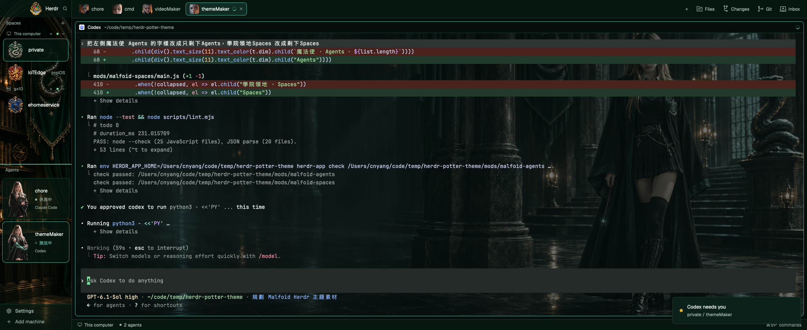

# Malfoid

把 Herdr 變成墨綠魔法學院：四學院徽章代表 Spaces，女巫姿態代表 agent 狀態，
終端以新完成的寬版走廊圖作背景，人物位於右側，以 cover 滿版顯示，底色不透明度為 0.35。

## What you see

左側 190px，可收合。頂部 46px 顯示霍格華茲校徽與 Herdr 字樣，中間上方領地、下方角色卡，底部 69px 設定列。
右側 48px 頭像分頁列、終端／檔案等面板、28px 狀態列。
主底 `#050E0B`、卡片 `#061710`、邊框 `#1F4637`，青綠焦點、金色等待提示。
每個 Space 列高 60px，學院徽章為 48px；依顯示順序循環使用史萊哲林、葛來分多、雷文克勞、赫夫帕夫，工作樹子列維持 28px 並使用原本分支圖示。
每張角色卡使用 72×96 圖片、6px 內距，只顯示名稱、狀態與程式名稱。
四個面板空狀態以 `image()` 顯示 `malfoid-spaces/art/` 的 72px 房間圖示，錯誤時不顯示。
Spaces 與 Agents 以 2px accent 分隔線分開；右側 panel 使用 sidebar.png 作背景。

## How it behaves

`working` 每 3 秒同步切換施法中、思考中的文字與姿態，相鄰卡交錯，青綠狀態燈呼吸；`blocked` 托球，金色文字與外框；
`done` 舉杖微笑，薄荷綠狀態；`idle` 抱書休息。未知狀態回到休息姿態。
卡片點擊執行 `agent.focus`，Spaces 點擊切換、右鍵開選單、同機器內可排序。
分頁與面板保留 Traveler 的操作，面板開關按 space 記憶。
Tab 從 10 張照片頭像隨機配圖，以 Tab ID 存在 localStorage；改名、排序或重畫不換圖，10 張用完才重複。

## Built from

`layouts/malfoid.json` 的 root row 包含 sidebar column 與 work column，
sidebar 使用 `malfoid-chrome`、`malfoid-spaces`、`malfoid-agents`；work 使用 `malfoid-tabs`、
Herdr 內建 pane／workspace-status，以及 malfoid-files／malfoid-changes／malfoid-inbox／malfoid-git-graph。
後四者為既有面板的主題專用複本，根底色使用 chrome 的 60% 不透明度，讓 panel 背景圖透出。
原本四個模組改自本機 Traveler，使用 `agents`、`spaces`、`panes`、`readTextFile`、`watchFolder`、`run`；
Spaces 保留上游 Git 查詢與 `hc machine ls`。工作動作用 1 秒計時器重繪（僅在有 agent 工作時），文字與 PNG 才能同步，各卡依列表順序錯開；狀態燈使用 `.loop("opacity", ...)`，不使用高頻計時器。
美術為角色照片、使用者素材表、使用者提供的去背五態人像（543×724 透明）與空城堡、手寫 SVG 小圖示。

## Watch out

此版本以本機 Herdr 0.1.12 為準，需要已安裝的 inbox 與 git-graph。
各姿態為固定畫面，working 以兩張姿態（Working／Thinking）輪替，由時間決定，不代表 agent 實際在做什麼；沒有獨立 Thinking 狀態或八角色換裝。
模組不能匯入自己資料夾以外的 JavaScript；不要跨模組共用 lib。
原生 check 不涵蓋完整畫面與稍後載入的資料，必須搭配 `herdr-app status` 和 `herdr-app shot`。
所有安裝路徑獨立，撞名時停止，既有 layout 保留可切回。

## Done when

1. `node --test` 與 `node scripts/lint.mjs` 通過。
2. 八個 `herdr-app check` 通過，四態卡片的原生 gallery 檢查通過。
3. 切換後 `herdr-app status` 沒有新模組錯誤，截圖可見角色、學院徽章與墨綠面板。
4. 角色卡沒有用量條或數值，Space 列縮小後 Git 資訊仍可見，新底圖上的終端內容仍清楚可讀。
